# minibrain architecture

The target design. The code is being refactored toward it; `ROADMAP.md` tracks what is built.

## In one paragraph

Production runs on GPU racks, rented or on-prem; a laptop install is onboarding. One install is one supervised process
tree started by one command. `main` is the control plane: it owns the database, the jobs, the policies and the
configuration. Gateways and engines are the data plane: they answer inference requests from a cached configuration, so
they keep serving while `main` restarts. Workers and engines talk to `main` only over HTTP, so a GPU box elsewhere is
the same program with a URL, a token and a pool name. A common shape: `main` on a small VM or a laptop, GPU workers and
engines on racks.

## Roles

Four roles. Locally they are one process tree; deployed, each is its own service on its own machines.

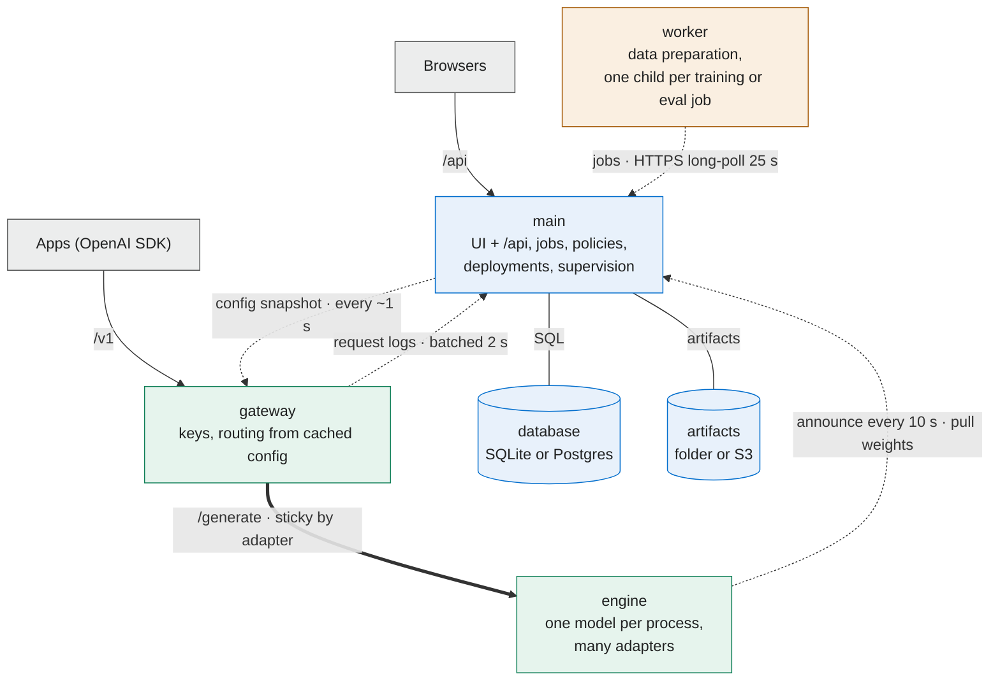

Colour is the plane: blue control, green serving, amber batch. Thick arrows carry inference, dotted ones carry config,
logs, announcements and jobs.

| Role | Local (`minibrain serve`) | Deployed | Scales by | Talks to the database |
|---|---|---|---|---|
| main | The parent process | Its own service; two or more with Postgres | Copies behind a load balancer, for availability | Yes, the only one |
| gateway | Inside main | `minibrain gateway` | Copies behind a load balancer | No: cached config snapshot |
| worker | A supervised child | `minibrain worker --pool …` on each GPU box | More boxes per pool | No: HTTP to main |
| training / eval | A child of the worker | Same, on the worker's box | One per job | No |
| engine | A supervised child per model | `minibrain engine --pool …` on each GPU box | Copies per model, across boxes | No: HTTP to main |
| database | A SQLite file | Postgres, highly available | Managed | |
| artifacts | A folder | S3-compatible storage | Managed | |

## Deployment shapes

Same roles, same code; only where they run changes. The three pictures share one layout: callers on the left, the
inference path across the top, main and its state in the middle, GPU pools on the right. Labels give the protocol,
the frequency and, in production, the port. The interactive version adds failure drills.

### 1. One machine: onboarding and evaluation

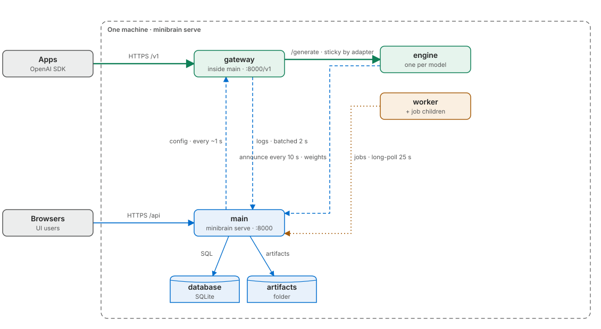

### 2. Local main, remote GPUs

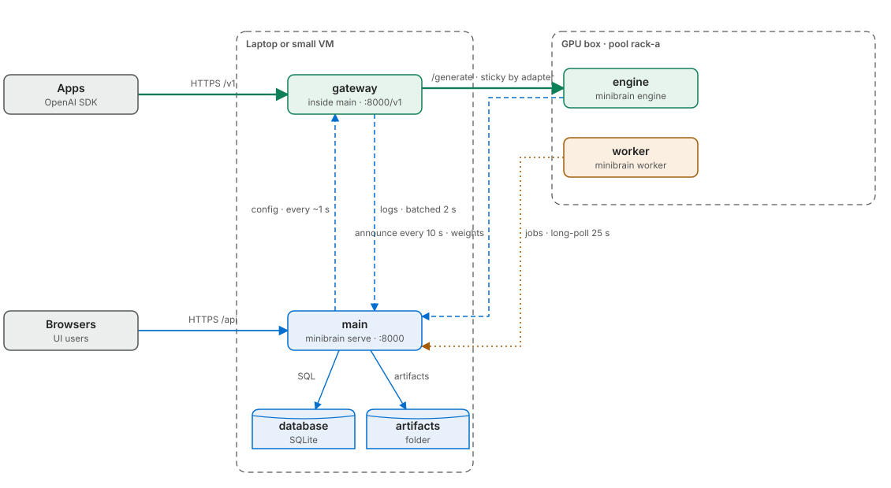

### 3. Production: separate services

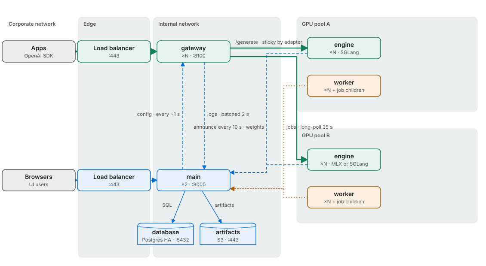

| Zone | Holds | Accepts connections from | Ports |
|---|---|---|---|
| Corporate network | Apps, browsers | | |
| Edge | Load balancers | The corporate network | 443 |
| Internal network | Gateways, mains, Postgres, S3 | The edge; GPU pools reach main only | gateway 8100, main 8000, Postgres 5432, S3 443 |
| GPU network | Workers, engines | Engines: gateways only. Workers: nothing | Outbound HTTPS to main 8000 |

| | One machine | Local main, remote GPUs | Production |
|---|---|---|---|
| main | `minibrain serve` | `minibrain serve` on a laptop or small VM | Two or more behind a load balancer |
| Gateways | Inside main | Inside main | `minibrain gateway` ×N behind a load balancer |
| Workers and engines | Local children, pool "This machine" | On GPU boxes, one pool per rack | GPU racks, several pools |
| Database | SQLite | SQLite | Postgres, highly available |
| Artifacts | Folder | Folder | S3-compatible |

### Who starts the processes

| Stage | Who starts workers and engines |
|---|---|
| v1 | People or their tooling: `minibrain worker` and `minibrain engine` on each box (systemd, Compose, Slurm) |
| v2 | A Kubernetes launcher: main creates Jobs for training and Deployments for engine replicas, autoscaled |
| Later | A cloud VM launcher for rented GPUs |

## Control plane and data plane

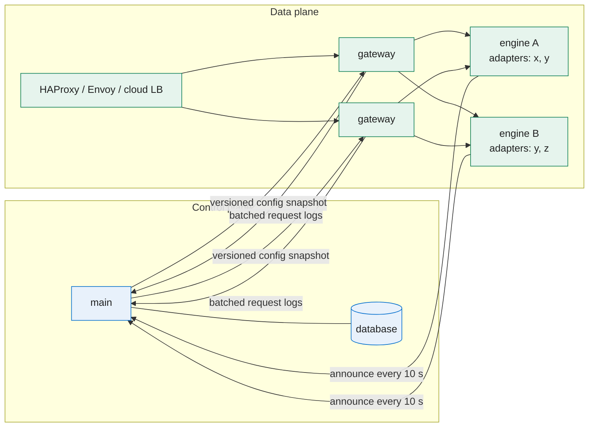

- `main` publishes a versioned config snapshot: routes, current versions, key hashes and expiry, engine replicas per
  model, the request-log switch.
- Gateways keep the last good snapshot on disk and serve from it. A `main` outage or upgrade pauses the UI and new
  jobs, not inference.
- Rolling back a deployment is republishing an earlier snapshot.

## Request path

An inference request never touches the database.

| Step | Source |
|---|---|
| Key, scope, expiry | In-memory config snapshot (key hashes) |
| Route, version, adapter | Same snapshot |
| Engine replicas for the model | Same snapshot, refreshed from engine announcements |
| Replica choice | Per-gateway memory: in-flight counts, sticky map, health from 5 s checks |
| Request log, key last-used | Buffered, written in batches every ~2 s |

- Config is up to ~1 s stale: a revoked key stays valid for at most a second.
- Scale out: more gateway replicas behind HAProxy, Envoy or a cloud load balancer, then more engines. GPUs are the
  bottleneck long before gateways or the database.
- Very high log volume moves to ClickHouse or Parquet in object storage, or to sampling.

## Flows

### Inference request

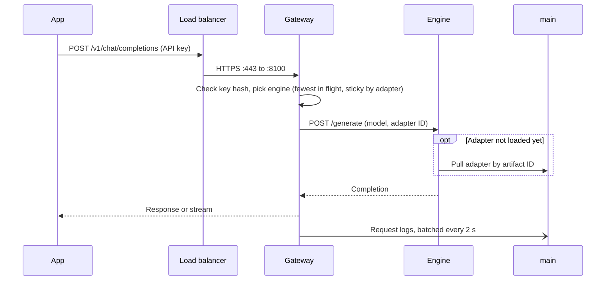

### Training job

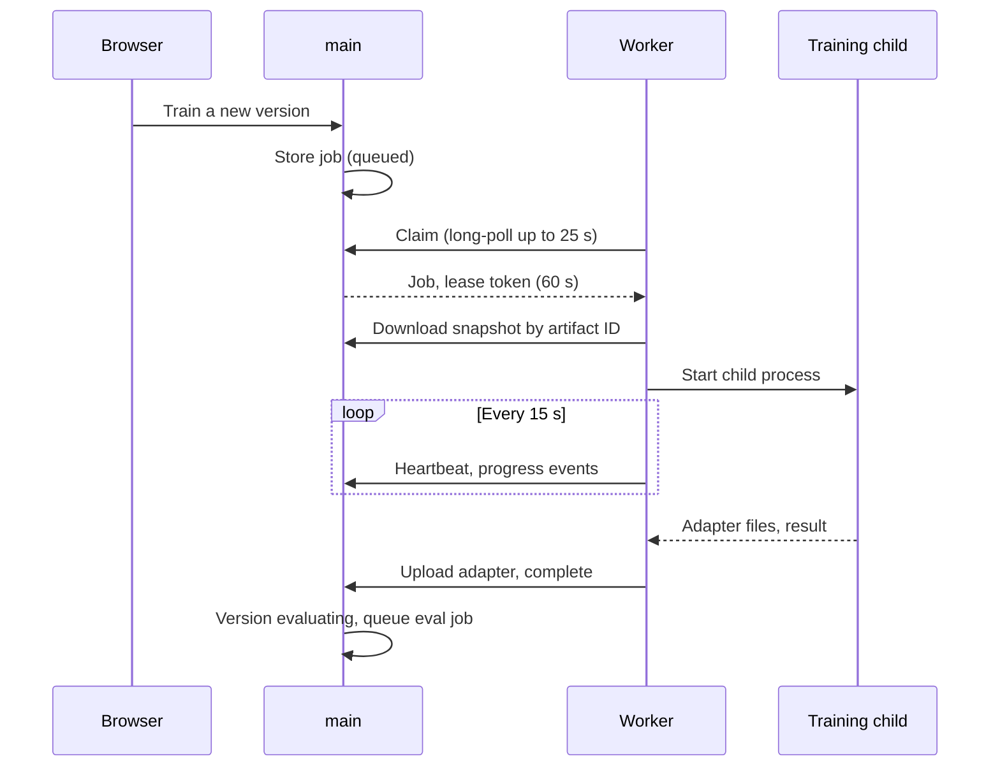

### Deploy a version

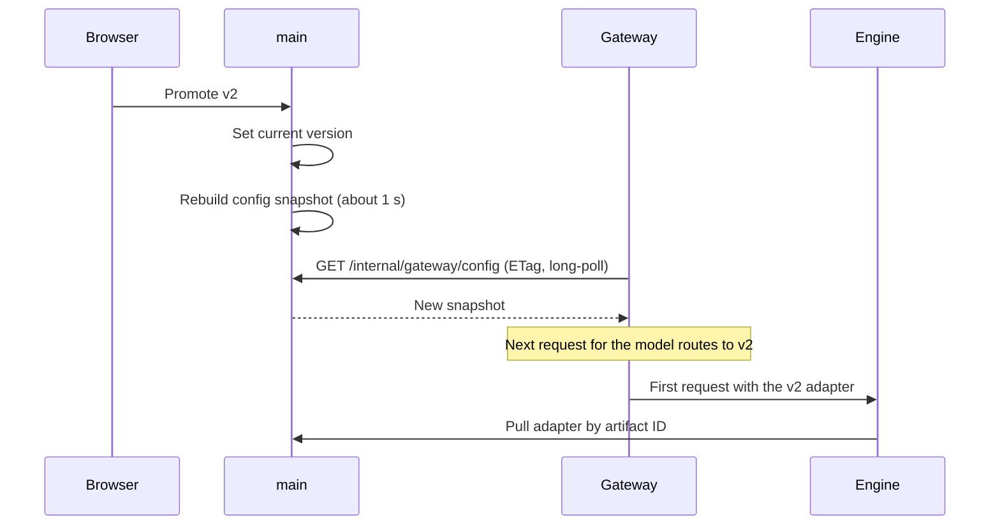

### An engine joins

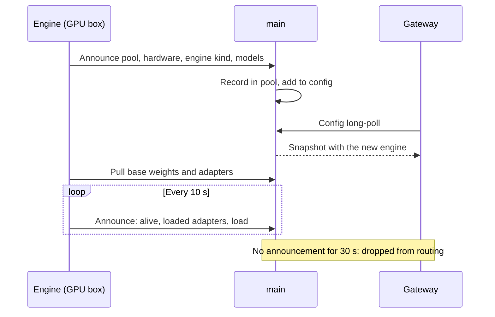

## Compute pools

A pool is a named group of machines. Workers and engines join one with `--pool NAME` (default `local`, shown as "This
machine") and report their hardware when they register, each time a worker asks for work and each time an engine
announces itself.

| Reported | Example |
|---|---|
| Platform, architecture | `linux`, `x86_64` |
| Accelerator | `cuda`, `rocm`, `mps`, `cpu`, with the GPU name |
| GPUs | Each with its memory |
| Memory for models | Sum of GPU memory; Apple GPU-usable unified memory; RAM on CPU |
| CPU, RAM | Cores, bytes |
| Engines installed | `sglang`, `mlx`, `transformers`, `llamacpp` |

- The Compute page lists pools, their machines (online if seen in the last 2 minutes) and the engines serving.
- Discover judges hardware fit against the selected pool: the best machine in the pool decides. Multi-GPU (XL)
  models need a machine with two or more GPUs.
- Machines unseen for 7 days and engines unseen for an hour are forgotten.

## Engines

One engine process serves one base model with many adapters. It picks its engine when it starts, from its own
hardware and the model's weight format:

| Node | Weights | Engine |
|---|---|---|
| Linux, NVIDIA or AMD (ROCm), SGLang installed | safetensors | SGLang (`--enable-lora`, adapters loaded at runtime) |
| Apple silicon, `minibrain[mlx]` | safetensors | MLX (`mlx-lm`; PEFT LoRA converted on load, swapped per request) |
| Anything else | safetensors | `transformers` + PEFT |
| Any, `minibrain[llamacpp]` | GGUF | llama.cpp (Metal, CUDA or CPU); base models only |

- `--engine` overrides the choice. An automatic choice that fails to load falls back to `transformers`.
- Engines of different kinds serve at the same time: a Mac engine on MLX and a rack engine on SGLang can be replicas of
  one model.
- Remote engines: `minibrain engine --model KEY --main-url URL --pool NAME --host 0.0.0.0` pulls weights and adapters
  from `main`, never from Hugging Face, and announces its URL, engine and hardware every 10 s.
- `main` starts a local engine for a deployed model only when no live replica serves it elsewhere, and starts one
  again when the remote replicas go away.
- Scale is horizontal: more replicas of the same model, on Kubernetes autoscaled. Heavy engines are optional extras;
  SGLang pins its own torch and CUDA, so it runs from its own environment (`MINIBRAIN_SGLANG_PYTHON`).

## Routing

Each gateway routes per model across its replicas, with no new setting:

| Rule | Detail |
|---|---|
| Health | Ready replicas first, then loading; a failed request or health check marks a replica down for 10 s |
| Least busy | New work goes to the replica with the fewest requests in flight |
| Sticky | By adapter (so the adapter stays loaded), by prompt prefix for base models (so the KV cache is reused) |
| Overflow | A sticky replica with 4 requests in flight hands new requests to a less busy one; the binding stays |
| Failover | Another replica is tried at once; the key rebinds to the replica that answered |

In front of gateways: HAProxy, Envoy or a cloud load balancer. Under the gateway, per pool, later: sgl-router or llm-d.

### Why sgl-router and llm-d come later

- llm-d needs Kubernetes (Gateway API inference extension, its own scheduler); minibrain must run without it.
- sgl-router only routes SGLang and pays off with many SGLang replicas of one model; then it slots under the gateway as
  one replica per pool, and the gateway keeps keys, routes and adapters.

## Model catalogue

- Built at release by `scripts/build_catalog.py` from live Hugging Face metadata and bundled as a snapshot. At runtime
  minibrain never calls Hugging Face for the catalogue; the optional sync reads only our own catalogue URL
  (`MINIBRAIN_CATALOG_URL`).
- Rules: approved publishers (Qwen, Google, Meta, Mistral, Microsoft, IBM, NVIDIA, DeepSeek, OpenAI gpt-oss, Allen AI,
  HuggingFaceTB), instruct or chat variants, reviewed commercial licences, architectures our engines support,
  safetensors present.
- Every generation stays; older ones show "Newer version available".
- Size tiers: S ≤4B, M 7–14B, L 24–35B or a small mixture of experts, XL 70B+ (multi-GPU).
- Default order: recommended for the selected pool. Filters: size, task, publisher.
- Add from Hugging Face: paste a link or id; `main` reads that one repository's metadata, on request, from the
  configured endpoint (Hugging Face or a mirror), checks `config.json`'s architecture and badges the entry "Tested by
  us", "Supported architecture" or "Untested". Policies apply.

## Security policies

Settings → Security. Values from `minibrain.yaml` (`policy:`) or `MINIBRAIN_POLICY_<NAME>` are locked in the UI and
show "Set by config file" or "Set by environment"; the rest are editable, and every change is written to the audit
log with who, before and after.

| Policy | Values | Enforced at |
|---|---|---|
| Network | Open, Allowlist (hosts), Offline (`MINIBRAIN_OFFLINE` forces it) | Downloads, retries, S3 imports, catalogue sync, Add from Hugging Face, the online check |
| Model sources | Approved publishers, any (badged untested), imports only | Download, retry, Add from Hugging Face |
| Licences | Allowlist of reviewed licences; unreviewed ones off by default | Download, retry |
| Safetensors only | Always on | Download file filter; pickle weights are never loaded |
| Request logs | On or off, retention in days | Gateway config; hourly purge on the leader |
| API keys | Expiry in days for new keys | Gateway rejects expired keys with 401 |

Remote engines pull from `main`, so GPU boxes need no outbound access.

## Jobs

Every long-running task is a job on one contract. `main` owns job state; workers execute.

| Kind | Does | Produces |
|---|---|---|
| `prepare` | Reads the source, applies the mapping or SQL, cleans, splits, hashes | Snapshot |
| `train` | LoRA training on a snapshot | Adapter, checkpoints |
| `eval` | Scores a version on the held-out and test splits | Eval results |
| `download` / `import` | Fetches pinned model weights from the hub, a mirror, S3 or a folder | Model files |
| `catalog_sync` | Reads our catalogue URL | Catalogue entries |
| `label` | Teacher labels rows or generates Q&A | Labelled data |
| `index` | Embeds sources, builds the retrieval index | Index |
| `batch` | Runs a version over a file, snapshot or query | Batch results |

### Lifecycle

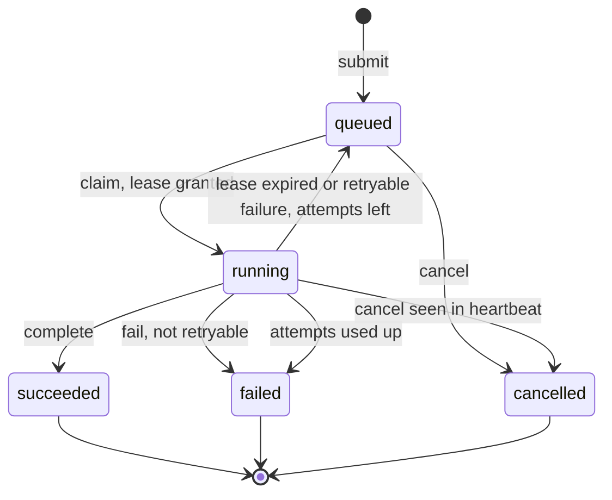

### Contract

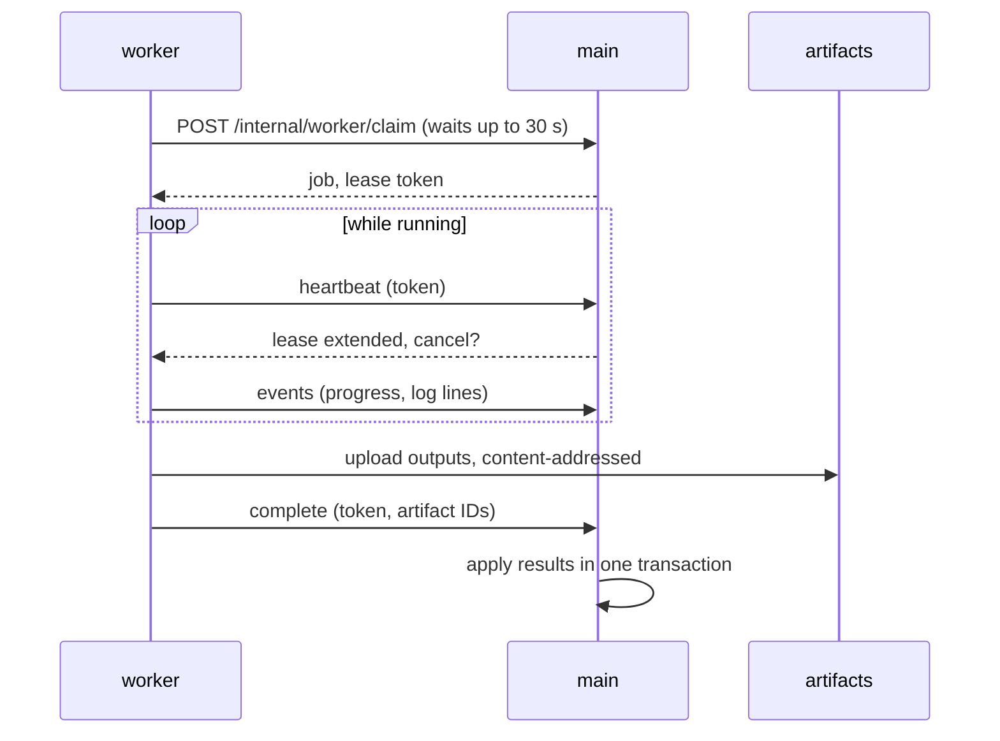

- A job is stored before it runs; the API returns its ID at once.
- The lease token fences stale workers: if a lease expires and the job moves on, the old worker's report is rejected.
- Delivery is at least once, so jobs are idempotent: outputs are content-addressed and committed atomically, and
  training resumes from its last checkpoint.
- Side effects that must happen once, such as promoting a version, happen in `main` inside a transaction, never in a
  worker.

### Retries and failures

| Cause | Retried |
|---|---|
| Lost heartbeat, worker crash | Yes |
| Out of memory, engine died, network, disk full | Yes |
| Bad input or config, schema mismatch, policy refusal | No |
| The same error twice in a row | No |
| Cancelled | Never |

- Backoff: `min(10 min, 30 s × 2^(attempt − 1))` with jitter; three attempts per job by default.
- Each attempt is kept with its worker, times, error and log.
- `failed` is the dead-letter queue: inspect, retry (a new job linked by `retry_of`) or discard.
- Priorities, per-kind and per-minibrain concurrency limits, timeouts, idempotency keys and backpressure are columns
  and checks at claim time.

## Artifacts

Files are passed by SHA-256 ID, never by path: sources, snapshots, adapters, checkpoints, eval results, logs, batch
results. The store is a local folder or S3-compatible storage; workers and engines keep local caches. Base model
weights are pinned by repository and revision. Today artifacts and weights flow through `main`; at scale workers and
engines read S3 directly.

## Database

SQLAlchemy 2 and Alembic, with no database-specific code. `MINIBRAIN_DATABASE_URL` picks SQLite (the default) or
Postgres. SQLite is enough with one `main`, because only `main` writes and the data plane does not depend on it.

### Several mains

With Postgres, several mains share the database behind a load balancer. One holds a session-level Postgres advisory
lock and runs the leader-only loops; the others stand by and serve the UI, `/api` and their gateway.

| Loop | Runs on |
|---|---|
| Job lease expiry | Leader |
| Catalogue sync schedule | Leader |
| Request log purge, forgetting stale machines | Leader |
| Gateway config rebuild | Every main (each serves its own gateways) |
| Idle engine unload | Every main (its own local engines) |

- Lease expiry: if the leader dies, its session ends and Postgres releases the lock; the next main to ask takes over.
  TCP keepalives bound how long a partitioned leader's session lingers. Leader-only work is idempotent, so a short
  overlap is harmless.
- The Compute page shows whether this main runs the loops ("Runs here", "Runs here (leader)", "Standby").
- A single SQLite box stays a single, non-HA main.
- No ZooKeeper or etcd of our own: consensus is delegated to Postgres HA (Patroni, a managed Postgres) and, on
  Kubernetes, to Kubernetes.

### Why not a "faster" database

Metadata is small and written at a low rate: jobs, versions, keys, engine announcements, batched logs. Postgres does
thousands of writes a second; the bottleneck is GPUs. Dremio, by contrast, embeds RocksDB per coordinator and needs
ZooKeeper to coordinate them; minibrain keeps one external, replicated database and nothing else to operate.

## Failure modes

| Fails | Effect | Mitigation |
|---|---|---|
| main | UI and new jobs pause; inference and running jobs continue | Restart in seconds; leases get a grace period; several mains on Postgres |
| Database | Same as main | Litestream for SQLite; replicated Postgres |
| Artifact store | New jobs and new adapter loads wait | Replicated S3; local caches |
| One gateway | Nothing, with two or more | Stateless copies behind a load balancer |
| One engine | Nothing, with two or more replicas | Health checks; the gateway fails over and rebinds |
| One worker | Jobs wait | More workers |

## Tradeoffs

| Choice | Gives | Costs | Later |
|---|---|---|---|
| Single control plane (main + database) | One source of truth, simple ops | main is a dependency for changes | Postgres + several mains for HA |
| HTTP pull from workers and engines | Outbound-only GPU boxes, no DB credentials outside main | Artifacts through main | S3 direct at scale |
| Own job queue | Leases, fencing, one table, no broker | We own the bugs | DBOS for multi-step pipelines |
| Database polling | No broker, works on SQLite | Up to a poll interval of latency | Postgres LISTEN/NOTIFY |
| Config up to ~1 s stale | No database read per request | A revoked key works for ≤1 s | |
| One model per engine process | Simple lifecycle, many adapters per model | More processes | Replicas scale horizontally; Kubernetes autoscaling |
| One package does everything | One install, one version | Large install | Split extras later |
| Python gateway | Same code and models as main | More replicas than a native proxy | Go or Rust proxy only if ever needed |
| No Kubernetes requirement | Runs on a laptop and air-gapped boxes | Manual workers and engines in v1 | Kubernetes launcher in v2 |

## Decisions

- No Compose or Kubernetes locally: Docker on macOS has no GPU, and `uvx minibrain serve` must work air-gapped.
- Own jobs table: Procrastinate is Postgres-only, Huey keeps a second job record without leases, Celery / RQ /
  Dramatiq need a broker, Temporal / Hatchet / Prefect are separate servers. DBOS Transact is the candidate for
  multi-step pipelines inside `main`.
- Workers and engines over HTTP: no database credentials outside `main`, outbound-only traffic from GPU boxes, one
  SQLite writer.
- HTTP, not gRPC: the job channel carries a few requests per second and inference is GPU-bound; HTTP with streaming
  serves both.
- No message broker or coordination service: the database coordinates jobs; a Postgres advisory lock picks the leader
  when `main` has several copies.
