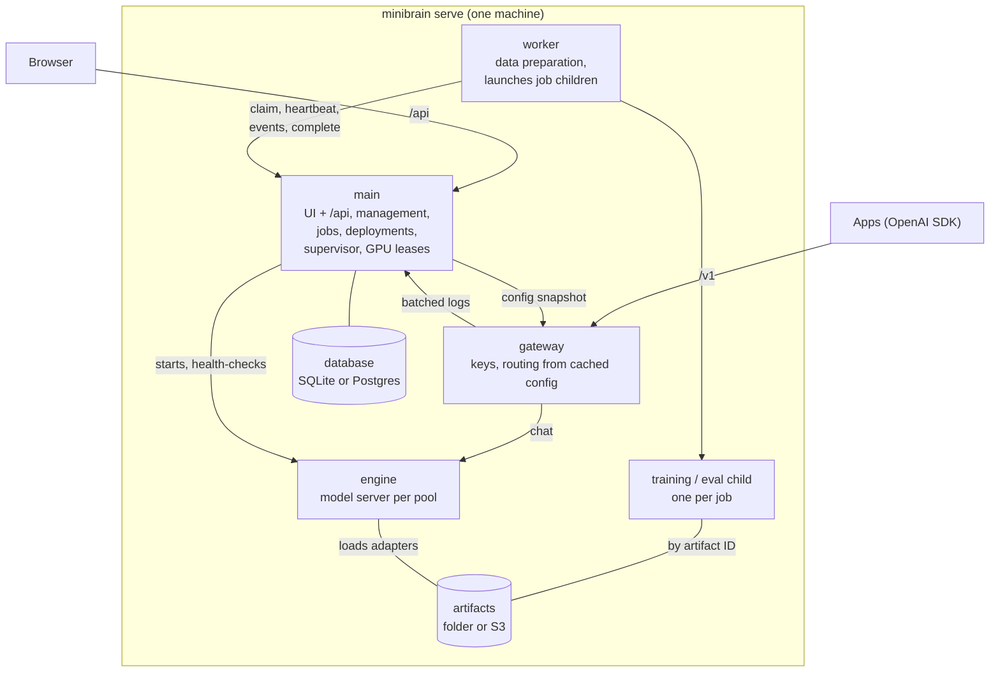
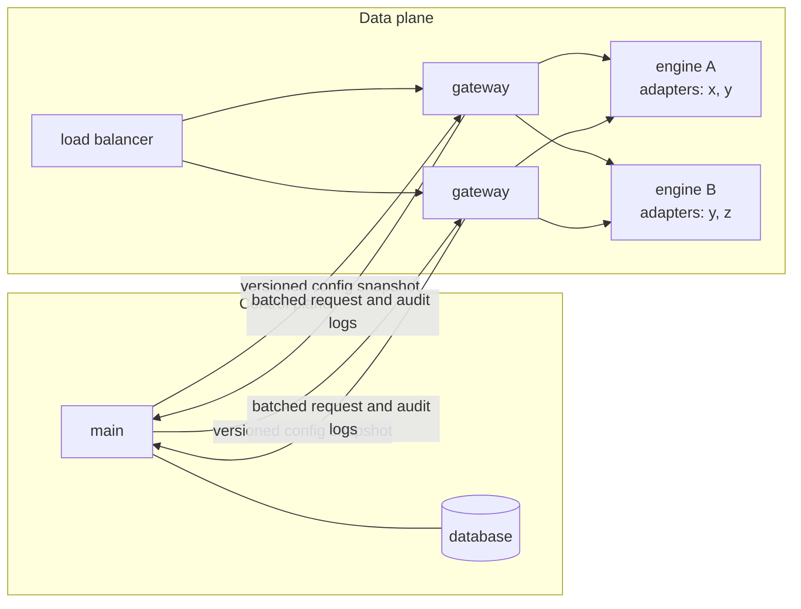
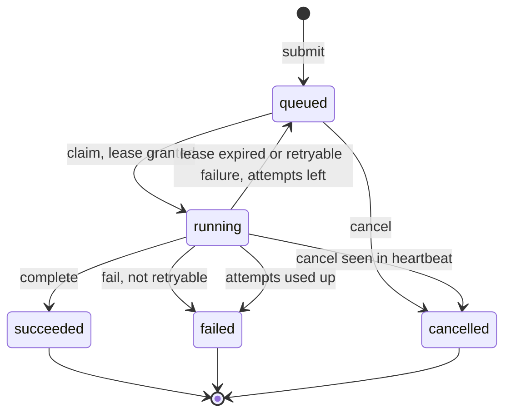
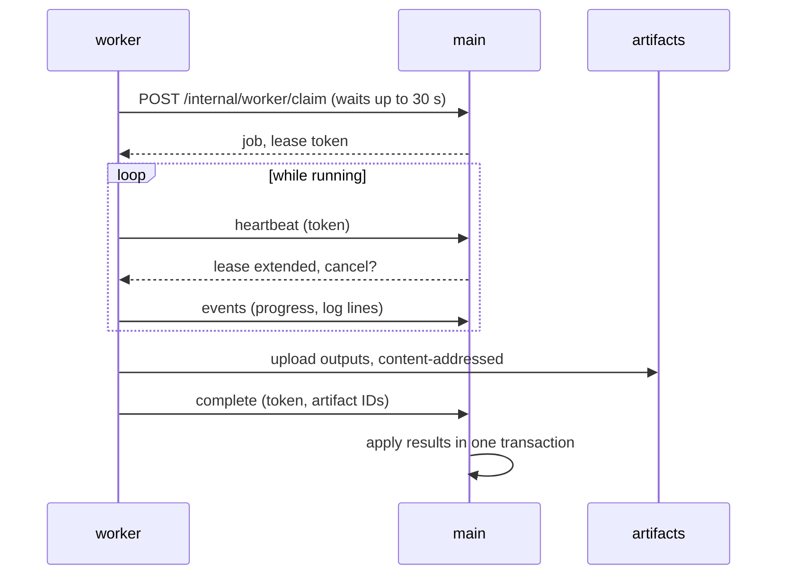
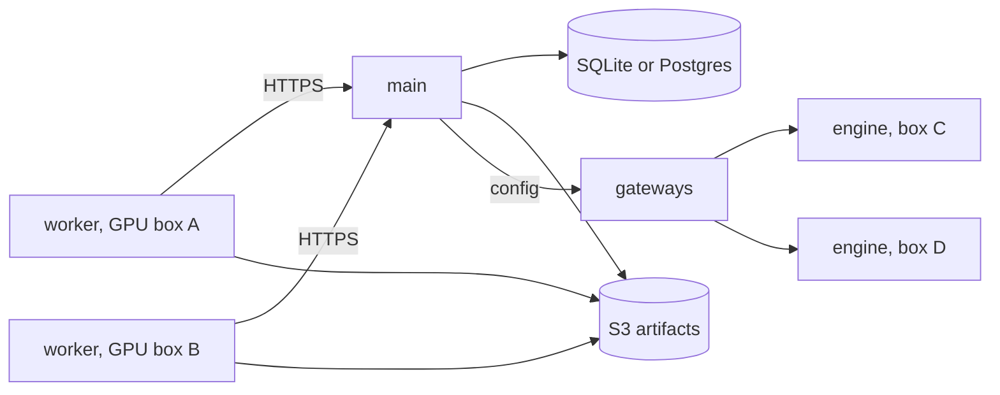

# minibrain architecture

The target design. The code is being refactored toward it; `ROADMAP.md` tracks what is built.

## In one paragraph

One install is one supervised process tree started by one command. `main` is the control plane: it owns the
database, the jobs and the configuration. Gateways and engines are the data plane: they answer inference requests from
a cached configuration, so they keep serving while `main` restarts. Workers run long jobs and talk to `main` only over
HTTP, so a worker on another machine is the same program with a URL and a token.

## Processes

| Process | Runs | Talks to the database |
|---|---|---|
| main | UI and `/api`, management, job submission, deployments, supervision, GPU leases | Yes, the only one |
| gateway | `/v1`: auth, routing, request and audit logs | No: cached config snapshot |
| worker | Data preparation; starts one child per training or eval job | No: HTTP to `main` |
| training / eval | One job each; writes checkpoints and results | No |
| engine | One model server per pool: SGLang, vLLM, or `transformers` / `llamacpp` locally | No |

`minibrain serve` runs every role. `--role api|gateway|worker|engine` runs one, which is how Compose, Helm or
Kubernetes split them in production.

## Control plane and data plane

- `main` publishes a versioned config snapshot: routes, current versions, which engines hold which adapters, key
  hashes, limits.
- Gateways keep the last good snapshot on disk and serve from it. A `main` outage or upgrade pauses the UI and new
  jobs, not inference.
- Rolling back a deployment is republishing an earlier snapshot.
- Gateways send a request to an engine that already has the adapter loaded; engines load adapters on demand and evict
  the least used, so many minibrains share a few GPUs.

## Jobs

Every long-running task is a job on one contract. `main` owns job state; workers execute.

| Kind | Does | Produces |
|---|---|---|
| `prepare` | Reads the source, applies the mapping or SQL, cleans, splits, hashes | Snapshot |
| `train` | LoRA training on a snapshot | Adapter, checkpoints |
| `eval` | Scores a version on the held-out and test splits | Eval results |
| `label` | Teacher labels rows or generates Q&A | Labelled data |
| `index` | Embeds sources, builds the retrieval index | Index |
| `batch` | Runs a version over a file, snapshot or query | Batch results |

### Lifecycle

### Contract

- A job is stored before it runs; the API returns its ID at once.
- The lease token fences stale workers: if a lease expires and the job moves on, the old worker's report is rejected.
- Delivery is at least once, so jobs are idempotent: outputs are content-addressed and committed atomically, and
  training resumes from its last checkpoint.
- Side effects that must happen once, such as promoting a version, happen in `main` inside a transaction, never in a
  worker.

### Retries and failures

| Cause | Retried |
|---|---|
| Lost heartbeat, worker crash | Yes |
| Out of memory, engine died, network, disk full | Yes |
| Bad input or config, schema mismatch | No |
| The same error twice in a row | No |
| Cancelled | Never |

- Backoff: `min(10 min, 30 s × 2^(attempt − 1))` with jitter; three attempts per job by default.
- Each attempt is kept with its worker, times, error and log.
- `failed` is the dead-letter queue: inspect, retry (a new job linked by `retry_of`) or discard.
- Priorities, per-kind and per-minibrain concurrency limits, timeouts, idempotency keys and backpressure are columns
  and checks at claim time.

## Artifacts

Files are passed by SHA-256 ID, never by path: sources, snapshots, adapters, checkpoints, eval results, logs, batch
results. The store is a local folder or S3-compatible storage; workers and engines keep local caches. Base model
weights are pinned by repository and revision.

## Database

SQLAlchemy 2 and Alembic, with no database-specific code. `MINIBRAIN_DATABASE_URL` picks SQLite (the default) or
Postgres. SQLite is enough with one `main`, because only `main` writes and the data plane does not depend on it.
Postgres adds a `main` that fails over without downtime.

## Deployed

| | Local | Deployed |
|---|---|---|
| Metadata | SQLite | SQLite; Postgres for a highly available `main` |
| Artifacts | Folder | S3-compatible |
| Workers | Local processes | Local or remote, same contract |
| Engines | Local children | Local or remote, routed by gateways |
| Roles | One process tree | Separate processes or services |

## Failure modes

| Fails | Effect | Mitigation |
|---|---|---|
| main | UI and new jobs pause; inference and running jobs continue | Restart in seconds; leases get a grace period after restart; Postgres for HA |
| Database | Same as main | Litestream for SQLite; replicated Postgres |
| Artifact store | New jobs and new adapter loads wait | Replicated S3; local caches |
| One gateway | Nothing, with two or more | Stateless copies behind a load balancer |
| One engine | Nothing, with two or more per pool | Health checks; gateway retries another engine |
| One worker | Jobs wait | More workers |

## Decisions

- No Compose or Kubernetes locally: Docker on macOS has no GPU, and `uvx minibrain serve` must work air-gapped.
- Own jobs table: Procrastinate is Postgres-only, Huey keeps a second job record without leases, Celery / RQ /
  Dramatiq need a broker, Temporal / Hatchet / Prefect are separate servers. DBOS Transact is the candidate for
  multi-step pipelines inside `main`.
- Workers over HTTP: no database credentials outside `main`, outbound-only traffic from GPU boxes, one SQLite writer.
- HTTP, not gRPC: the job channel carries a few requests per second and inference is GPU-bound; HTTP with streaming
  serves both.
- No message broker or coordination service: the database coordinates jobs; a Postgres advisory lock picks the leader
  when `main` has several copies.
