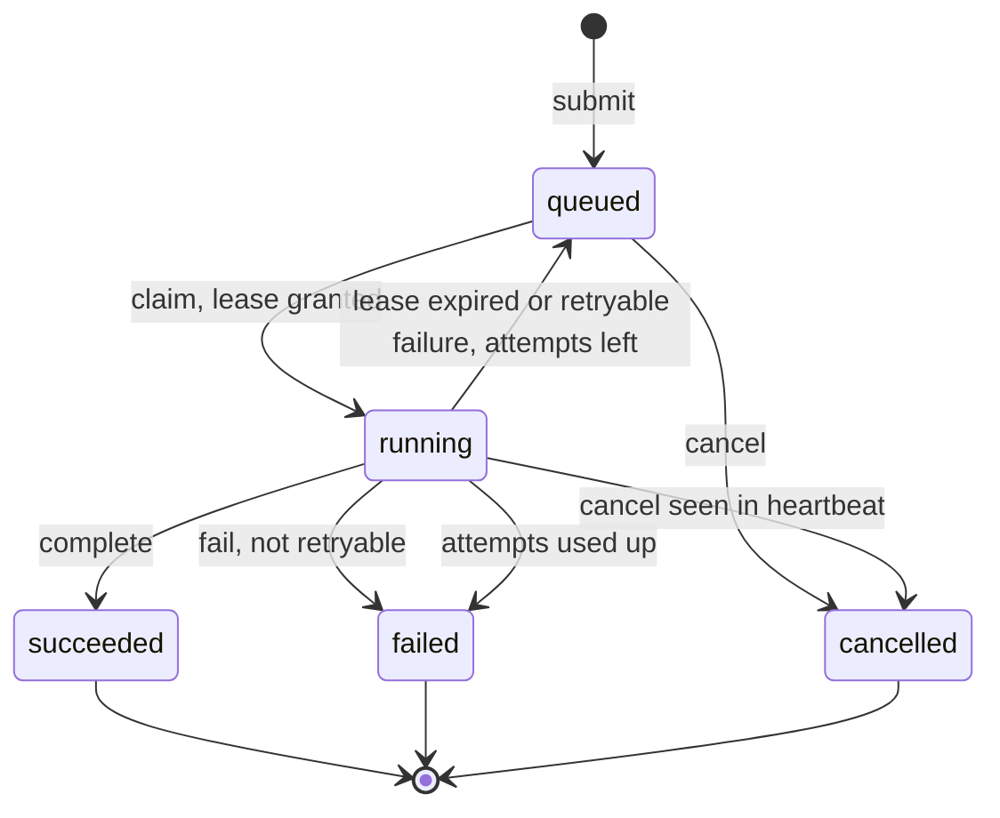
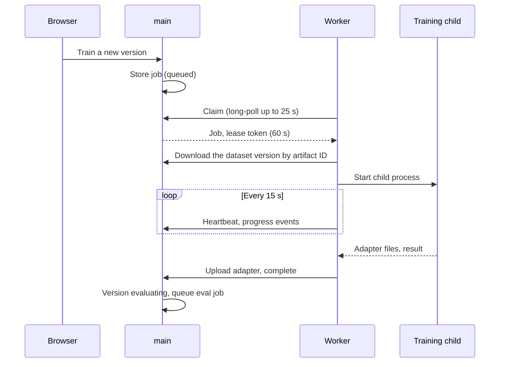

# Jobs

Every long-running task is a job on one contract. `main` owns job state; workers execute.

| Kind | Does | Produces |
|---|---|---|
| `train` | LoRA training on a dataset version | Adapter, checkpoints |
| `eval` | Scores a version on the held-out and test splits | Eval results |
| `judge` | Scores answers with a judge model and caches each score | Judge scores |
| `download` / `import` | Fetches pinned model weights from the hub, a mirror, S3 or a folder | Model files |
| `verify` / `repair` | Re-hashes a base's files; fetches the damaged ones again | File states, model files |
| `catalog_sync` | Reads our catalogue URL | Catalogue entries |
| `label` | Teacher labels rows or generates Q&A | Labelled data |
| `index` | Embeds sources, builds the retrieval index | Index |
| `batch` | Runs a version over a file, dataset version or query | Batch results |

## Lifecycle

## Contract

Endpoints under `/internal/worker` in [`web/openapi.json`](../web/openapi.json).

- A job is stored before it runs; the API returns its ID at once.
- Workers claim with a long-poll (up to 30 s) and get the job with a lease token (60 s). They heartbeat every 15 s with
  the token, which extends the lease and returns the cancel flag, and post progress and log lines as events.
- Outputs are uploaded content-addressed; `complete` carries the token and the artifact IDs, and `main` applies the
  results in one transaction.
- The lease token fences stale workers: if a lease expires and the job moves on, the old worker's report is rejected.
- Delivery is at least once, so jobs are idempotent: outputs are content-addressed and committed atomically, and
  training resumes from its last checkpoint.
- Side effects that must happen once, such as promoting a version, happen in `main` inside a transaction, never in a
  worker.

## Retries and failures

| Cause | Retried |
|---|---|
| Lost heartbeat, worker crash | Yes |
| Out of memory, engine died, network, disk full | Yes |
| Bad input or config, schema mismatch, policy refusal | No |
| The same error twice in a row | No |
| Cancelled | Never |

- Backoff: `min(10 min, 30 s × 2^(attempt − 1))` with jitter; three attempts per job by default.
- Each attempt is kept with its worker, times, error and log.
- `failed` is the dead-letter queue: inspect, retry (a new job linked by `retry_of`) or discard.
- Priorities, per-kind and per-minibrain concurrency limits, timeouts, idempotency keys and backpressure are columns
  and checks at claim time.

## Flow: training job

