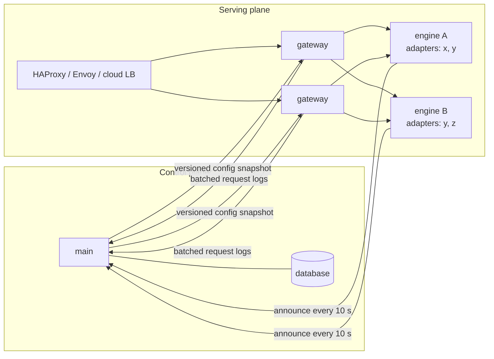
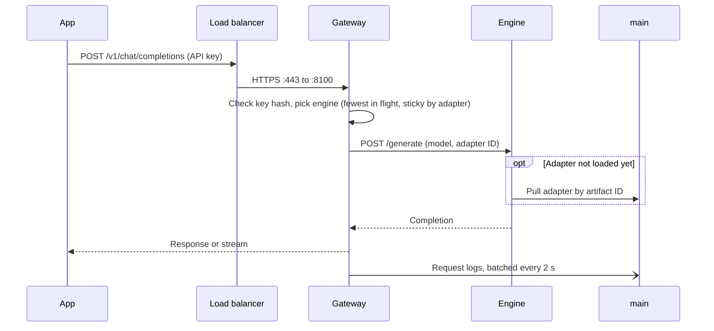
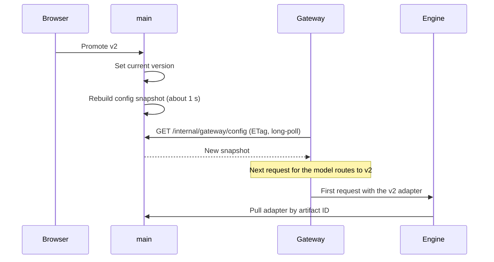
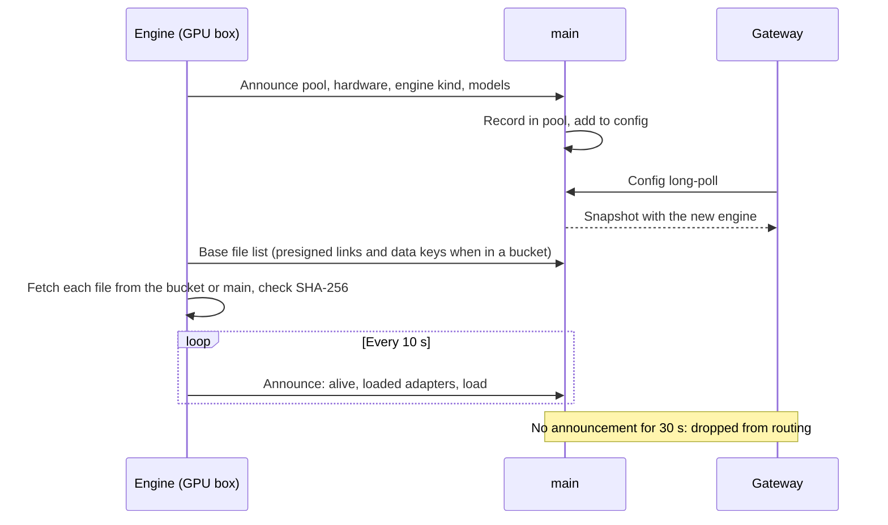

# Serving

## Control and serving planes

- `main` publishes a versioned config snapshot: routes, current versions, key hashes and expiry, engine replicas per
  model, the request-log switch.
- Gateways keep the last good snapshot on disk and serve from it. A `main` outage or upgrade pauses the UI and new
  jobs, not inference.
- Rolling back a deployment is republishing an earlier snapshot.
- Endpoints (`/v1`, `/internal/gateway`): [`web/openapi.json`](../web/openapi.json).

## Request path

An inference request never touches the database.

| Step | Source |
|---|---|
| Key, scope, expiry | In-memory config snapshot (key hashes) |
| Route, version, adapter | Same snapshot |
| Engine replicas for the model | Same snapshot, refreshed from engine announcements |
| Replica choice | Per-gateway memory: in-flight counts, sticky map, health from 5 s checks |
| Request log, key last-used | Buffered, written in batches every ~2 s |

- Config is up to ~1 s stale: a revoked key stays valid for at most a second.
- Scale out: more gateway replicas behind HAProxy, Envoy or a cloud load balancer, then more engines. GPUs are the
  bottleneck long before gateways or the database.
- Very high log volume moves to ClickHouse or Parquet in object storage, or to sampling.

## Streaming

`stream: true` sends `chat.completion.chunk` events as the engine generates them: `transformers` through a token
streamer, MLX through `stream_generate`, llama.cpp through its own stream, SGLang and vLLM by relaying their events,
and remote engines as newline-delimited JSON from `/generate`. The gateway splits each piece into `content`,
`reasoning_content` and `tool_calls` deltas as it goes (a tool call is sent whole once its closing tag arrives).

- An answer held to `response_format` or to a custom model's contract is generated in full, checked, then sent as
  events, so a 422 still arrives as a status code.
- `stream_options: {"include_usage": true}` adds OpenAI's final chunk with empty `choices` and `usage`; otherwise the
  usage rides on the chunk with `finish_reason`.
- A failure before the first token is an ordinary error response; one after it ends the stream with an `error` event
  and `data: [DONE]`. The request log is written when the stream ends, with its tokens and status.
- A gateway fails over to another replica only before the first byte of a stream.

## Sampling

`/v1/chat/completions` takes OpenAI's sampling fields and the engine extensions vLLM and SGLang share. A field left
out is not sent, so the model's default applies: its `generation_config.json` on `transformers` and MLX (greedy when
it has none), the engine's own default on SGLang, vLLM and llama.cpp. A custom model answers at temperature 0 unless
the request sets one, the way its scores were measured.

| Field | Range | SGLang, vLLM | llama.cpp | MLX | `transformers` |
|---|---|---|---|---|---|
| `max_tokens`, `max_completion_tokens` | 1 or more; unset: the context limit | Passed on | Passed on | Passed on | Passed on |
| `temperature` | 0 to 2 | Passed on | Passed on | `make_sampler` | `GenerationConfig` |
| `top_p` | above 0, up to 1 | Passed on | Passed on | `make_sampler` | `GenerationConfig` |
| `top_k` | 1 or more | Passed on | Passed on | `make_sampler` | `GenerationConfig` |
| `min_p` | 0 to 1 | Passed on | Passed on | `make_sampler` | `GenerationConfig` |
| `presence_penalty`, `frequency_penalty` | -2 to 2 | Passed on | Passed on | Logits processor | Logits processor |
| `repetition_penalty` | above 0, up to 2 | Passed on | `repeat_penalty` | `make_logits_processors` | `GenerationConfig` |
| `seed` | any integer | Passed on | Passed on | `mx.random.seed` | `torch.manual_seed` |
| `stop` | up to 4 texts | Passed on, after the model's stop tokens | Passed on | Checked as it decodes | `stop_strings` |

- A value out of range, `n` above 1, `logprobs` or `logit_bias` is a 400 with an OpenAI `error` object naming the
  field in `param`. So is any body that fails validation on `/v1/chat/completions`.
- An engine that cannot honour a field (an older `mlx-lm` without `top_k` or `min_p`, or a server that refuses one)
  answers 400 with `code: unsupported_parameter` and the field in `param`, never silently ignoring it.
- Without `max_tokens` the answer runs to the end of the model's context (`max_position_embeddings`, or 4,096 tokens
  for llama.cpp's window).

## Text completions

`/v1/completions` is OpenAI's legacy text completion API, for code completion and base models: `prompt` goes to the
engine as it is, without the chat template, and `choices[].text` is what follows it. It shares the chat path's keys,
`name@N` addressing, sampling fields, safety model, request log (`kind` `completion`, shown as the Endpoint on
Monitoring › Requests) and streaming (`text_completion` chunks ending with `data: [DONE]`).

- Each engine takes its raw-prompt path: `transformers` tokenizes the text with the tokenizer's BOS token in front
  (when it has one and the prompt lacks it), MLX encodes it with special tokens, llama.cpp passes it to
  `create_completion`, and SGLang and vLLM get it on their own `/v1/completions`. Remote engines carry it as `prompt`
  on `/generate`. The answer is read as plain text: no reasoning split, no tool calls.
- A custom model applies its live (or pinned) version's adapter but not its instructions, few-shot turns or contract;
  it answers at temperature 0 unless the request sets one, as in chat. A prompt-only version is its base model.
- `max_tokens` defaults to 16, as OpenAI's does. `prompt` may be a list holding one text; a longer list or token ids
  are a 400. So are `n` or `best_of` above 1, `logprobs`, `echo`, `suffix` and `logit_bias`; `user` is accepted and
  ignored.
- A blocked call answers with empty `text`, `finish_reason: content_filter` and the `safety` verdict.

## Structured output

`/v1/chat/completions` takes OpenAI's `response_format`: `{"type": "text"}`, `{"type": "json_object"}` or
`{"type": "json_schema", "json_schema": {"name", "schema", "strict"}}`.

| Request | SGLang | llama.cpp | MLX, `transformers` |
|---|---|---|---|
| Classify model, no `response_format` or `text` | Held to the labels (EBNF grammar) | Held to the labels (GBNF grammar) | Held to the labels (token trie) |
| `json_object` | Constrained (schema `{"type": "object"}`) | Constrained (grammar from the schema) | Free, then checked |
| `json_schema` | Constrained (`response_format` passed on) | Constrained (grammar from the schema) | Constrained when the schema has a finite set of answers (enums, booleans, objects of them); otherwise free, then checked |

- A custom model's contract is the default and stays in force: a request's `response_format` can only narrow a model
  whose contract is free text. A model that answers with labels or its own JSON schema refuses `json_object` and
  `json_schema` with a 400 (`param: response_format`, `code: unsupported_value`); `{"type": "text"}` is accepted and
  changes nothing. Base models take any format.
- A Classify answer stays the bare label, as before. If an engine refuses the label grammar, the gateway answers
  without it and logs a warning.
- Every JSON answer is checked against the schema in the gateway, whatever the engine. One that does not parse or
  match is a 422 with `error.code` `invalid_json` or `schema_mismatch`; an answer cut off by `max_tokens`
  (`finish_reason: length`) comes back as it is. A JSON answer inside a Markdown code fence is unwrapped.
- A malformed `response_format` or schema is a 400 with an OpenAI `error` object (`message`, `type`, `param`,
  `code`). A schema the engine cannot compile is a 400 too.
- Streaming works: the answer is checked, then streamed.
- The check covers `type`, `enum`, `const`, `properties`, `required`, `additionalProperties`, `items`,
  `prefixItems`, item and length bounds, number bounds, `anyOf`, `oneOf`, `allOf`, `not` and local `$ref`. It does
  not run `pattern` (a caller's regular expression could stall the gateway; llama.cpp applies it while decoding) or
  check `format`, `multipleOf` and `patternProperties`.
- `strict` is accepted and changes nothing: every answer is constrained, checked, or both.

## Tool calling

`/v1/chat/completions` takes OpenAI's `tools` (functions with JSON-schema `parameters`), `tool_choice` (`auto`,
`none`, `required` or a named function) and `parallel_tool_calls`. Answers carry `tool_calls` with
`finish_reason: tool_calls`, and follow-up turns send assistant messages with their `tool_calls` and `role: tool`
messages with each `tool_call_id`. Streams carry the calls as `delta.tool_calls`.

| Format | Read from | Families | SGLang parser | vLLM parser |
|---|---|---|---|---|
| `hermes` | `<tool_call>` JSON `</tool_call>` | Qwen 2.5 and 3, Hermes, SmolLM3 | `qwen25` | `hermes` |
| `llama3` | `{"name", "parameters"}` JSON, after `<|python_tag|>` or alone; `;` between calls | Llama 3.1, 3.2, 3.3 | `llama3` | `llama3_json` |
| `mistral` | `[TOOL_CALLS]` and a JSON list | Mistral 7B v0.3, Nemo, Small | `mistral` | `mistral` |
| `harmony` | the `commentary to=functions.<name>` channel | gpt-oss | `gpt-oss` | `openai` |

- The format comes from the base model's own chat template (`chat_template.jinja`, `tokenizer_config.json`, or the
  GGUF metadata), read once per weights hash, so imported and Hugging Face models get it too. A model whose template
  has none of these refuses `tools` with a 400.
- The template renders the tools: `transformers`, MLX and llama.cpp pass `tools` to the tokenizer's chat template
  (llama.cpp through the same Jinja renderer as `transformers`) and read the calls back from the raw answer; SGLang
  and vLLM start with the matching `--tool-call-parser` and get `tools` as they are.
- `required` and a named function prefill the answer with the format's call opening (`<tool_call>` plus the name
  for Qwen), so the model can only complete a call. `none` renders no tools. `parallel_tool_calls: false` keeps the
  first call.
- A model answering with labels or its own JSON schema takes no tools; a free-text custom model does, with its
  instructions first. Arguments the model writes as invalid JSON stay in `content`.
- `functions` and `function_call`, OpenAI's old names, are refused with a pointer to `tools`; content parts other
  than text are refused.

## Reasoning

`reasoning_effort` takes `none`, `low`, `medium` or `high`; unset keeps the model's default. The reasoning comes back
as `message.reasoning_content` (`delta.reasoning_content` when streaming), never in `content`, so request logs,
feedback and graders see only the answer.

| Style | Detected from the template | Families | `none` | `low`, `medium`, `high` | Read from |
|---|---|---|---|---|---|
| Toggle | `enable_thinking` | Qwen3 (not the 2507 Instruct models), GLM-4.5, SmolLM3 | Thinking off | Thinking on | `<think>` … `</think>` |
| Effort | `reasoning_effort` | gpt-oss | 400 | The effort | the harmony `analysis` channel |
| Always | `<think>` opened by the generation prompt | DeepSeek-R1 and its distills, Qwen3 Thinking 2507 | 400 | 400 | up to `</think>` |
| None | none of these | everything else | Accepted, changes nothing | 400 | |

- The default stays off for custom models and the catalogue's Qwen3 bases (`enable_thinking: false` in their
  template settings); a base imported without that setting follows its own template's default.
- A model answering with labels or its own schema does not reason: `none` is accepted, an effort is a 400.
- `transformers`, MLX and llama.cpp pass the setting to the chat template and split the answer; SGLang and vLLM get
  `chat_template_kwargs` (and `reasoning_effort` for gpt-oss) and start with `--reasoning-parser` (`qwen3`,
  `deepseek-r1` or `gpt-oss` on SGLang; `qwen3`, `deepseek_r1` or `openai_gptoss` on vLLM).
- Evaluation and judge jobs strip the reasoning too, so a reasoning base is scored on its answers.

## Safety model

A guard model installed like any base checks each request before the model answers it, and the answer too when
set. A blocked call answers 200 with OpenAI's refusal shape: `message.content: null`, `message.refusal` naming the
safety model and the categories it found, `finish_reason: content_filter`, and a `safety` object (`model`, `stage`
`prompt` or `answer`, `blocked`, `categories`). Streams send the refusal as `delta.refusal`.

| Guard | Detected from | Prompt | Categories |
|---|---|---|---|
| Llama Guard 3 (1B, 8B) | `llama-guard` in the repo or name | its chat template, roles merged to alternate | `S1` to `S14`, named |
| ShieldGemma (2B, 9B) | `shieldgemma` | its template with each of four policies as `guideline` | the policy that answered Yes |
| Qwen3Guard Gen (0.6B, 4B, 8B) | `qwen3guard` | its template (request or answer moderation) | its own; Controversial passes |
| gpt-oss-safeguard (20B, 120B) | `gpt-oss-safeguard` | a written policy as the system message, low effort | the category in its JSON answer |

- Which guard applies: a model's own choice on its Deployments page (a guard, or none), else the install's under
  Settings, General (none by default); base models served through `/v1` follow the install's. Both can also check
  answers. A request's `safety` field (`{"model": ..., "answers": true}`, an extension) can pick a guard for a model
  that has none and add the answer check, but cannot change or turn off the one set (400 `safety.model`).
- The guard runs greedily through the same engines as any base, and its engine starts with the configuration when
  it is set. If it cannot answer, the call fails with a 503 rather than going unchecked. Checking answers means the
  answer is generated in full before it streams.
- Blocked `/v1` calls keep their request log, with `finish_reason: content_filter` and the safety verdict
  (Monitor, Requests shows "Blocked by"), and add a `safety.block` audit event with the API key as actor, the stage,
  categories and response ID, never the content. Playground calls are audited with the person as actor. Changes
  to the settings are audited as `settings.safety` and `model.safety`.

## Engines

One engine process serves one base model with many adapters. It picks its engine when it starts, from its own
hardware and the model's weight format:

| Node | Weights | Engine |
|---|---|---|
| Linux, NVIDIA or AMD (ROCm), SGLang installed | safetensors | SGLang (`--enable-lora`, adapters loaded at runtime) |
| Linux, NVIDIA or AMD (ROCm), vLLM installed, no SGLang | safetensors | vLLM (`--enable-lora`, runtime LoRA updates on) |
| Apple silicon, `minibrain[mlx]` | safetensors | MLX (`mlx-lm`; PEFT LoRA converted on load, swapped per request) |
| Anything else | safetensors | `transformers` + PEFT |
| Any, `minibrain[llamacpp]` | GGUF | llama.cpp (Metal, CUDA or CPU); base models only |

- `--engine` overrides the choice. An automatic choice that fails to load falls back to `transformers`.
- Engines of different kinds serve at the same time: a Mac engine on MLX and a rack engine on SGLang can be replicas of
  one model.
- Remote engines: `minibrain engine --model KEY --main-url URL --pool NAME --host 0.0.0.0` pulls adapters from `main`
  and base weights from wherever Storage keeps them, never from Hugging Face, and announces its URL, engine and
  hardware every 10 s. With a bucket, `main` hands out a presigned link and the data key per file and the engine reads
  the bucket directly; with the folder, it reads the files from `main`. Either way it keeps a working copy in
  `<home>/engines/<key>/weights`, checks every file's size and SHA-256, and removes copies of models `main` no longer
  has when it starts and every 10 minutes.
- Local engines on `main` use `main`'s working copy, `<home>/models/<id>`, fetched from the bucket the first time they
  start when the model lives there.
- Fetching the working copy is its own step, before the engine loads the model: the engine answers `/health` with 503
  and `{"state": "fetching", "done", "total", "message"}`, announces state `fetching` (Infrastructure and the Models
  list say "Fetching weights") and logs its progress every 30 s. Each file gets a freshly signed link, so a fetch
  longer than the links' 15 minutes still completes. A request to a model that is still fetching waits up to 60 s,
  then gets a 503 that says how far the fetch is; the 600 s startup window starts only when loading starts. A fetch
  that fails says so and loads nothing.
- `main` starts a local engine for a deployed model only when no live replica serves it elsewhere, and starts one
  again when the remote replicas go away.
- Scale is horizontal: more replicas of the same model, on Kubernetes autoscaled. Heavy engines are optional extras;
  SGLang and vLLM pin their own torch and CUDA, so each runs from its own environment (`MINIBRAIN_SGLANG_PYTHON`,
  `MINIBRAIN_VLLM_PYTHON`). The vLLM engine shares SGLang's request path (an OpenAI-compatible server per base model)
  and has not been run on a GPU yet.

## Routing

Each gateway routes per model across its replicas, with no new setting:

| Rule | Detail |
|---|---|
| Health | Ready replicas first, then loading; a failed request or health check marks a replica down for 10 s |
| Least busy | New work goes to the replica with the fewest requests in flight |
| Sticky | By adapter (so the adapter stays loaded), by prompt prefix for base models (so the KV cache is reused) |
| Overflow | A sticky replica with 4 requests in flight hands new requests to a less busy one; the binding stays |
| Failover | Another replica is tried at once; the key rebinds to the replica that answered |

In front of gateways: HAProxy, Envoy or a cloud load balancer. Under the gateway, per pool, later: sgl-router or
llm-d. llm-d needs Kubernetes (Gateway API inference extension, its own scheduler), and minibrain must run without it.
sgl-router only routes SGLang and pays off with many SGLang replicas of one model; then it slots under the gateway as
one replica per pool, and the gateway keeps keys, routes and adapters.

## Compute pools

A pool is a named group of machines. Workers and engines join one with `--pool NAME` (default `local`, shown as "This
machine") and report their hardware when they register, each time a worker asks for work and each time an engine
announces itself.

| Reported | Example |
|---|---|
| Platform, architecture | `linux`, `x86_64` |
| Accelerator | `cuda`, `rocm`, `xpu`, `mps`, `cpu`, with the GPU name |
| GPUs | Each with its memory |
| Memory for models | Sum of GPU memory; Apple GPU-usable unified memory; RAM on CPU |
| CPU, RAM | Cores, bytes |
| Engines installed | `sglang`, `vllm`, `mlx`, `transformers`, `llamacpp` |

- The Compute page lists pools, their machines (online if seen in the last 2 minutes) and the engines serving.
- Discover judges hardware fit against the selected pool: the best machine in the pool decides. Multi-GPU (XL)
  models need a machine with two or more GPUs.
- Machines unseen for 7 days and engines unseen for an hour are forgotten.

## Flows

### Inference request

### Deploy a version

### An engine joins

