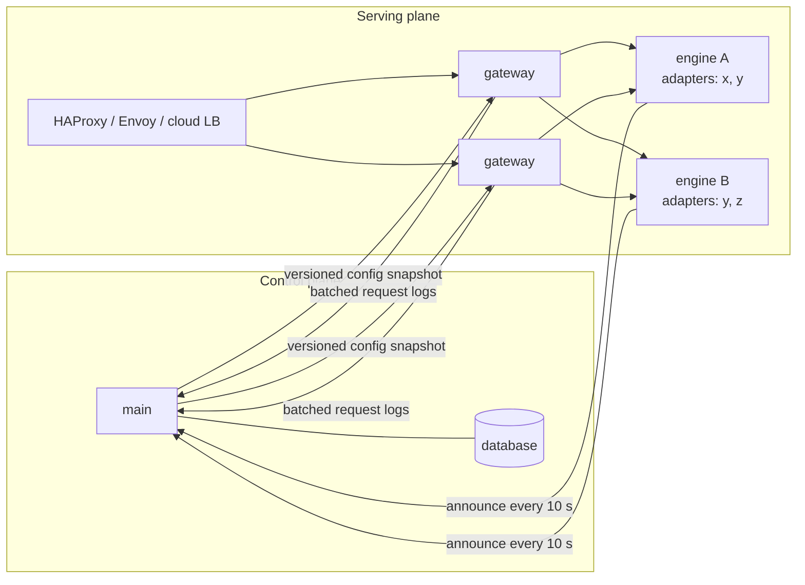
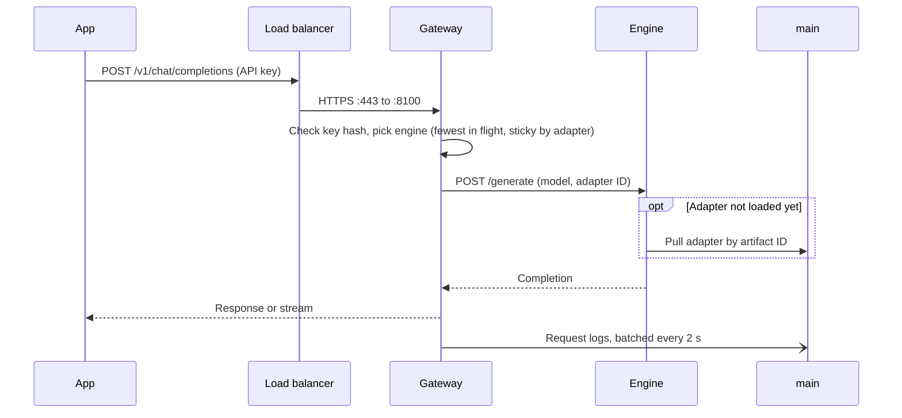
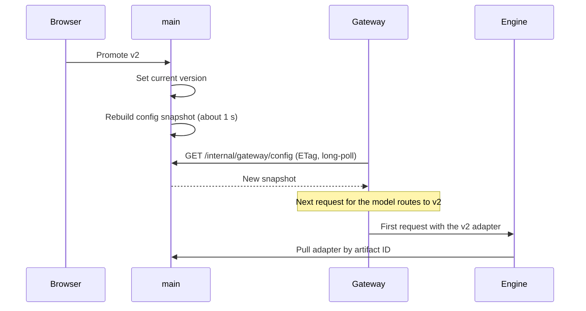
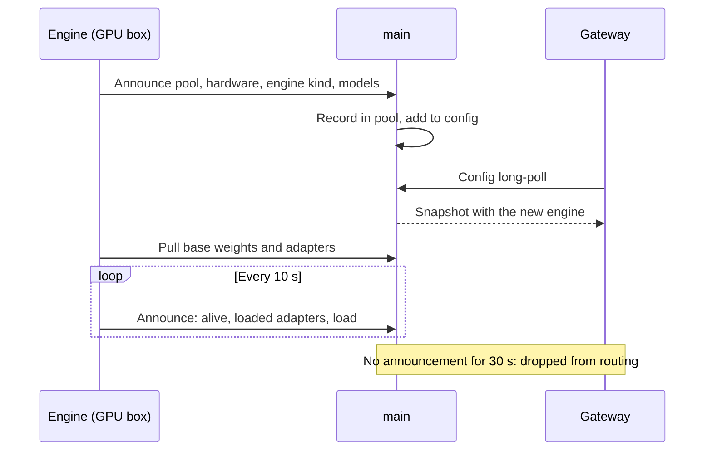

# Serving

## Control and serving planes

- `main` publishes a versioned config snapshot: routes, current versions, key hashes and expiry, engine replicas per
  model, the request-log switch.
- Gateways keep the last good snapshot on disk and serve from it. A `main` outage or upgrade pauses the UI and new
  jobs, not inference.
- Rolling back a deployment is republishing an earlier snapshot.
- Endpoints (`/v1`, `/internal/gateway`): [`web/openapi.json`](../web/openapi.json).

## Request path

An inference request never touches the database.

| Step | Source |
|---|---|
| Key, scope, expiry | In-memory config snapshot (key hashes) |
| Route, version, adapter | Same snapshot |
| Engine replicas for the model | Same snapshot, refreshed from engine announcements |
| Replica choice | Per-gateway memory: in-flight counts, sticky map, health from 5 s checks |
| Request log, key last-used | Buffered, written in batches every ~2 s |

- Config is up to ~1 s stale: a revoked key stays valid for at most a second.
- Scale out: more gateway replicas behind HAProxy, Envoy or a cloud load balancer, then more engines. GPUs are the
  bottleneck long before gateways or the database.
- Very high log volume moves to ClickHouse or Parquet in object storage, or to sampling.

## Structured output

`/v1/chat/completions` takes OpenAI's `response_format`: `{"type": "text"}`, `{"type": "json_object"}` or
`{"type": "json_schema", "json_schema": {"name", "schema", "strict"}}`.

| Request | SGLang | llama.cpp | MLX, `transformers` |
|---|---|---|---|
| Classify model, no `response_format` or `text` | Held to the labels (EBNF grammar) | Held to the labels (GBNF grammar) | Held to the labels (token trie) |
| `json_object` | Constrained (schema `{"type": "object"}`) | Constrained (grammar from the schema) | Free, then checked |
| `json_schema` | Constrained (`response_format` passed on) | Constrained (grammar from the schema) | Constrained when the schema has a finite set of answers (enums, booleans, objects of them); otherwise free, then checked |

- A Classify answer stays the bare label, as before. If an engine refuses the label grammar, the gateway answers
  without it and logs a warning.
- Every JSON answer is checked against the schema in the gateway, whatever the engine. One that does not parse or
  match is a 422 with `error.code` `invalid_json` or `schema_mismatch`; an answer cut off by `max_tokens`
  (`finish_reason: length`) comes back as it is. A JSON answer inside a Markdown code fence is unwrapped.
- A malformed `response_format` or schema is a 400 with an OpenAI `error` object (`message`, `type`, `param`,
  `code`). A schema the engine cannot compile is a 400 too.
- Streaming works: the answer is checked, then streamed.
- The check covers `type`, `enum`, `const`, `properties`, `required`, `additionalProperties`, `items`,
  `prefixItems`, item and length bounds, number bounds, `anyOf`, `oneOf`, `allOf`, `not` and local `$ref`. It does
  not run `pattern` (a caller's regular expression could stall the gateway; llama.cpp applies it while decoding) or
  check `format`, `multipleOf` and `patternProperties`.
- `strict` is accepted and changes nothing: every answer is constrained, checked, or both.

## Engines

One engine process serves one base model with many adapters. It picks its engine when it starts, from its own
hardware and the model's weight format:

| Node | Weights | Engine |
|---|---|---|
| Linux, NVIDIA or AMD (ROCm), SGLang installed | safetensors | SGLang (`--enable-lora`, adapters loaded at runtime) |
| Apple silicon, `minibrain[mlx]` | safetensors | MLX (`mlx-lm`; PEFT LoRA converted on load, swapped per request) |
| Anything else | safetensors | `transformers` + PEFT |
| Any, `minibrain[llamacpp]` | GGUF | llama.cpp (Metal, CUDA or CPU); base models only |

- `--engine` overrides the choice. An automatic choice that fails to load falls back to `transformers`.
- Engines of different kinds serve at the same time: a Mac engine on MLX and a rack engine on SGLang can be replicas of
  one model.
- Remote engines: `minibrain engine --model KEY --main-url URL --pool NAME --host 0.0.0.0` pulls weights and adapters
  from `main`, never from Hugging Face, and announces its URL, engine and hardware every 10 s.
- `main` starts a local engine for a deployed model only when no live replica serves it elsewhere, and starts one
  again when the remote replicas go away.
- Scale is horizontal: more replicas of the same model, on Kubernetes autoscaled. Heavy engines are optional extras;
  SGLang pins its own torch and CUDA, so it runs from its own environment (`MINIBRAIN_SGLANG_PYTHON`).

## Routing

Each gateway routes per model across its replicas, with no new setting:

| Rule | Detail |
|---|---|
| Health | Ready replicas first, then loading; a failed request or health check marks a replica down for 10 s |
| Least busy | New work goes to the replica with the fewest requests in flight |
| Sticky | By adapter (so the adapter stays loaded), by prompt prefix for base models (so the KV cache is reused) |
| Overflow | A sticky replica with 4 requests in flight hands new requests to a less busy one; the binding stays |
| Failover | Another replica is tried at once; the key rebinds to the replica that answered |

In front of gateways: HAProxy, Envoy or a cloud load balancer. Under the gateway, per pool, later: sgl-router or
llm-d. llm-d needs Kubernetes (Gateway API inference extension, its own scheduler), and minibrain must run without it.
sgl-router only routes SGLang and pays off with many SGLang replicas of one model; then it slots under the gateway as
one replica per pool, and the gateway keeps keys, routes and adapters.

## Compute pools

A pool is a named group of machines. Workers and engines join one with `--pool NAME` (default `local`, shown as "This
machine") and report their hardware when they register, each time a worker asks for work and each time an engine
announces itself.

| Reported | Example |
|---|---|
| Platform, architecture | `linux`, `x86_64` |
| Accelerator | `cuda`, `rocm`, `mps`, `cpu`, with the GPU name |
| GPUs | Each with its memory |
| Memory for models | Sum of GPU memory; Apple GPU-usable unified memory; RAM on CPU |
| CPU, RAM | Cores, bytes |
| Engines installed | `sglang`, `mlx`, `transformers`, `llamacpp` |

- The Compute page lists pools, their machines (online if seen in the last 2 minutes) and the engines serving.
- Discover judges hardware fit against the selected pool: the best machine in the pool decides. Multi-GPU (XL)
  models need a machine with two or more GPUs.
- Machines unseen for 7 days and engines unseen for an hour are forgotten.

## Flows

### Inference request

### Deploy a version

### An engine joins

